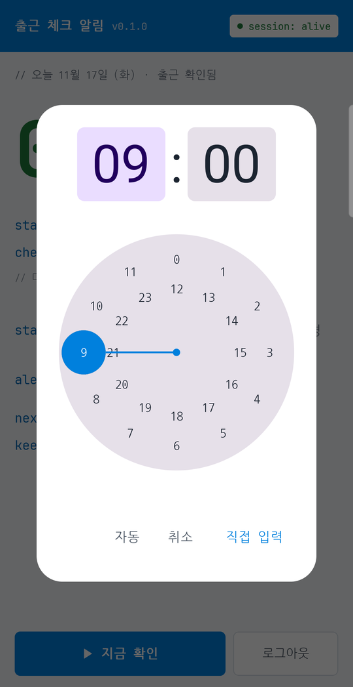

# 출근 체크 알림 (Check-in Reminder for Hiworks)

하이웍스 근태관리에서 출근 체크를 잊지 않도록, 출근 시각 전에 아직 출근을 찍지 않았으면 알림을 보내는 Android 앱입니다.

> **비공식 도구입니다.** 하이웍스나 가비아와 관계가 없고, 공식 API가 아닌 웹에서 쓰는 API를 호출합니다. 하이웍스 쪽 변경으로 언제든 동작하지 않을 수 있습니다. 「하이웍스」는 해당 회사의 상표입니다.

## 화면

| 메인 화면 | 알림 시각 | 출근 시각 |
| :---: | :---: | :---: |
|  |  |  |

출근 전까지 출근 체크를 하지 않았으면 이런 알림이 옵니다. 누르면 하이웍스 앱이 열립니다.

## 설치

[Releases](https://github.com/Bluewind8791/checkin-reminder-for-hiworks/releases/latest)에서 `app-release.apk`를 받아 설치합니다. Play 스토어 밖의 앱이라 「출처를 알 수 없는 앱 설치」를 허용해야 합니다.

처음 열면 앱 안에서 하이웍스에 로그인하고, 알림 권한을 허용하세요.

## 하는 일

- 근무 일정에서 오늘의 출근 시각을 읽고, 휴일·휴가인 날은 건너뜁니다.
- 출근 시각 전에 출근 여부를 확인하고, 아직 출근 전이면 알림을 보냅니다. 알림 시각은 출근 1~60분 전 사이에서 1~5개를 정할 수 있습니다(기본 10·5·1분 전). 출근이 확인되면 남은 알림은 취소합니다.
- 로그인 세션이 끊기지 않도록 3시간마다 조회 요청을 한 번 보냅니다.

## 하지 않는 일

- **출근을 대신 찍지 않습니다.** 조회(GET)만 하고 출근 등록 요청은 보내지 않습니다.
- 비밀번호를 저장하지 않습니다. 앱 안의 WebView로 직접 로그인하면 세션 쿠키(`PHPSESSID`)만 암호화해 기기에 저장합니다.
- `*.office.hiworks.com` 외의 서버와 통신하지 않습니다.

## 빌드

- JDK 17, Android SDK 35
- `./gradlew assembleDebug`
- 최소 Android 8.0 (API 26)
- release 빌드는 Gradle 사용자 홈의 `gradle.properties`에 `checkinReminder.storeFile`, `checkinReminder.storePassword`, `checkinReminder.keyAlias`, `checkinReminder.keyPassword`가 있을 때만 서명됩니다. 없으면 서명되지 않은 APK가 나옵니다.

정확한 시각에 알림을 보내려고 `USE_EXACT_ALARM` 권한을 씁니다. 배터리 최적화 예외는 필수가 아니지만, 알림이 늦게 오면 설정해 주세요.

## 라이선스

[MIT](LICENSE). 포함된 폰트(JetBrains Mono, 나눔고딕코딩)는 SIL Open Font License를 따르며, 라이선스 원문은 `app/src/main/assets/licenses/`에 있습니다.
